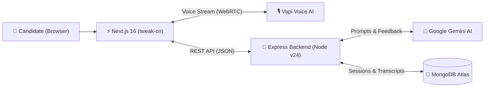

# 🎙️ InterviewAI — AI-Powered Mock Interview Platform

<p align="center">
  <strong>Master technical interviews with real-time conversational voice AI and in-depth Gemini rubric evaluations.</strong>
</p>

<p align="center">
  
  
  
  
  
  
  
  
</p>

---

## 🌟 Overview

**InterviewAI** is an intelligent mock interview platform designed to simulate realistic technical hiring loops. 

Candidates configure their target role, seniority level, and tech stack. Google Gemini dynamically generates targeted technical and system design questions. Candidates then enter an interactive voice room powered by Vapi to answer in real time. Upon completion, Gemini analyzes the conversation transcript and delivers a rubric evaluation with actionable study plans.

---

## ✨ Key Features

| Feature | Description |
| :--- | :--- |
| 🎙️ **Real-Time Voice AI** | Conversational, hands-free voice interviews powered by **Vapi** with live speech visualizer and transcript streaming. |
| 🧠 **Tailored AI Question Generation** | **Google Gemini** crafts role-specific questions for any stack (React, Node, Go, Kubernetes, System Design, etc.) and experience level. |
| 📊 **Multi-Dimensional Rubric Scoring** | Automated evaluation across **5 core competencies**: Communication, Technical Knowledge, Problem Solving, Cultural Fit, and Confidence. |
| 📋 **Interactive Candidate Prep Plan** | Built-in interactive study checklist allowing candidates to mark growth areas as resolved while preparing. |
| 🌓 **Light / Dark / System Theme Switcher** | Designed with **tweak-cn** design tokens, fully responsive with instant one-click theme switching. |
| 🎛️ **Custom Interactive Controls** | Custom dual-track sliders with quick presets (3, 5, 7, 10 questions) and time estimates. |

---

## 🏛️ System Architecture



---

## 📁 Repository Structure

```text
├── frontend/                     # Next.js 16 (App Router + Tailwind v4 + tweak-cn)
│   ├── src/
│   │   ├── app/
│   │   │   ├── layout.tsx        # Root HTML layout with ThemeProvider
│   │   │   ├── page.tsx          # Dashboard & session explorer
│   │   │   ├── globals.css       # tweak-cn HSL design tokens & dark theme
│   │   │   └── interviews/[id]/
│   │   │       ├── page.tsx      # Interactive Vapi voice interview room
│   │   │       └── feedback/     # Multi-view evaluation report & scorecard
│   │   ├── components/           # Navbar, ThemeToggle, CreateModal, InterviewCard
│   │   ├── lib/                  # Backend API clients & TypeScript interfaces
│   │   └── utils/                # Vapi client factory & environment loaders
│   └── package.json
│
├── backend/                      # Node.js + Express + TypeScript
│   ├── src/
│   │   ├── config/               # MongoDB Atlas connection & auto-seeder
│   │   ├── controller/           # Interview and Feedback request handlers
│   │   ├── models/               # Mongoose schemas for Interview & Feedback
│   │   ├── routes/               # Express REST route endpoints
│   │   ├── services/             # Google Gemini interaction service
│   │   └── index.ts              # Express server entry point (Port 5001)
│   └── package.json
```

---

## 🚀 Quickstart Guide

### 1. Prerequisites
- **Node.js** v20+ (tested on Node v24)
- **MongoDB Atlas** cluster URI (or local MongoDB)
- **Google Gemini API Key** ([Google AI Studio](https://aistudio.google.com/))
- **Vapi Account & Public Key** ([Vapi Dashboard](https://dashboard.vapi.ai/))

---

### 2. Backend Setup

```bash
# Navigate to backend
cd backend

# Install dependencies
npm install

# Configure environment variables
cp .env.example .env # or edit .env directly
```

Your `backend/.env` should contain:
```env
PORT=5001
MONGO_URI=mongodb+srv://<username>:<password>@cluster0.mongodb.net/interview_ai
GEMINI_API_KEY=your_gemini_api_key_here
GEMINI_LLM_MODEL=gemini-3.5-flash-lite
```

Start the backend development server:
```bash
npm run dev
# Server will run on http://localhost:5001
# Auto-connects to MongoDB Atlas and seeds starter sessions
```

---

### 3. Frontend Setup

Open a new terminal tab:

```bash
# Navigate to frontend
cd frontend

# Install dependencies
npm install

# Configure environment variables
```

Your `frontend/.env` should contain:
```env
# Vapi Public Key (From Vapi Dashboard -> Account -> API Keys -> Public Key)
NEXT_PUBLIC_VAPI_PUBLIC_KEY=your_vapi_public_key_here

# Vapi Assistant ID (configured in Vapi dashboard)
NEXT_PUBLIC_VAPI_ASSISTANT_ID=your_assistant_id_here

# Express Backend URL
NEXT_PUBLIC_API_URL=http://localhost:5001/api
```

Start the frontend development server:
```bash
npm run dev
# App will run on http://localhost:3000
```

---

## 🔌 API Reference

### Interviews (`/api/interviews`)
| Method | Endpoint | Description |
| :--- | :--- | :--- |
| `GET` | `/api/interviews` | Fetch all saved interview sessions |
| `GET` | `/api/interviews/:id` | Fetch single interview session by ID |
| `POST` | `/api/interviews` | Generate questions via Gemini and create interview |
| `PATCH`| `/api/interviews/:id` | Update interview details |
| `POST` | `/api/interviews/:id/end` | Mark interview finalized |

### Feedback (`/api/feedback`)
| Method | Endpoint | Description |
| :--- | :--- | :--- |
| `POST` | `/api/feedback` | Generate evaluation report from conversation transcript |
| `GET` | `/api/feedback/:id` | Retrieve evaluation report by interview ID |

### Health Check (`/api/health`)
| Method | Endpoint | Description |
| :--- | :--- | :--- |
| `GET` | `/api/health` | Service health status and timestamp |

---

## 🛠️ Technology Stack

- **Frontend**: Next.js 16 (Turbopack, App Router), React 19, Tailwind CSS v4, `tweak-cn`, `tw-animate-css`, `next-themes`, Lucide Icons.
- **Voice Engine**: `@vapi-ai/web` WebRTC/WebSocket streaming.
- **Backend**: Node.js, Express, TypeScript, Mongoose.
- **AI Core**: `@google/genai` (Google Gemini 3.5 Flash Lite).
- **Database**: MongoDB Atlas.

---


